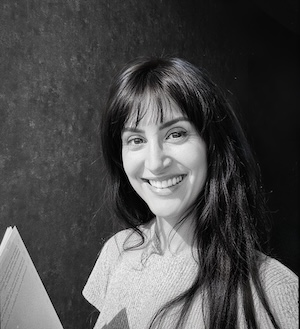

**24 November 2026 – Hybrid Event (Sorbonne Université, Paris & Online)**  
*Organized by the HCAI Working Group of the GDR IHM.*

We are pleased to announce our 2nd annual one-day workshop dedicated to exploring current research in Human-Centred AI (HCAI) in France. This event brings together researchers, practitioners, and students interested in designing and understanding AI systems that place humans at the center. 

This year event is dedicated to **researching across and between disciplines**. We will explore the challenges that come up in human-centred AI when different fields meet, such as artificial intelligence, design, anthropology, systems engineering, law, and cognitive sciences (among others).

The program features: **keynote talks** by Gonzalo Ramos and Gabrielle Benabdallah and **research presentations** followed by discussions. 

### Attendance

This workshop will be held in **hybrid format**, welcoming participants both:

- **In person** at the Institute for Institute for Intelligent Systems and Robotics (ISIR), Sorbonne Université, Paris ([see access map below](#access))
- **Online via Zoom**, for those unable to travel (Zoom link soon available)

### Program

| 09:30 | Coffee (in the workshop Room) |
| 10:00 | Welcome by Baptiste Caramiaux & Janin Koch |
| 10:15 | **Keynote 1: Gonzalo Ramos** |
| 11:00 | Break |
| 11:20 | Human movement analysis, Machine Learning |
| 12:00 | Human-AI Collaboration and Artistic Practice |
| 12:40 | Lunch served for registered participants |
| 14:00 | Group activity |
| 14:15 | **Keynote 2: Gabrielle Benabdallah** - *Writing as Material Practice in the Age of Language Models* |
| 15:00 | Break |
| 15:20 | Specialized work |
| 16:00 | Agency, specialized work |
| 16:40 | Break |
| 17:00 | Final discussion and conclusions |
| 18:00 | End / afterwork |

### Presentation details

Soon

### Keynote details

#### Keynote 1: Gonzalo Ramos (Director of Research, CNRS, Sorbonne Université)

 

#### Keynote 2: Gabrielle Benabdallah (Postdoctoral fellow, University of Washington)

 

**Writing as Material Practice in the Age of Language Models**

*In this talk, I discuss large language models as the latest in a line of writing technologies that runs from the clay tokens of ancient Mesopotamia to the GPT tokens sold by the million today, and ask what that material history can teach us about designing convivial approaches to language models. To engage this question, I draw on interpretability research, which studies the internal representations of language models, and on computational poetics to argue that these representations constitute a formal materiality that can be worked as an expressive material. I share early experiments that use a model’s internal activations to compose, among other things, poetry, and show how such representations of a model’s hidden layers can support both creative practices and the goals of interpretability, by making the complex operations inside these models something people can experience. The goal of this project is to open the surface of language models to interpretation, intervention, and possibly, reconfiguration.*

### Access map

The event will take place at ISIR, in **room 211** (between towers 55 and 65). 

Lunch will be served in the same room. 

### Acknowledgements

The organization of this event was supported by CNRS, Sorbonne Université, ISIR (Institute for Intelligent Systems and Robotics). 